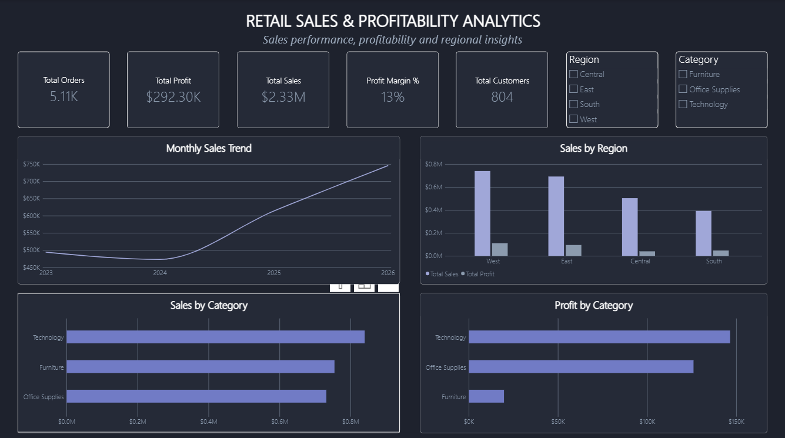
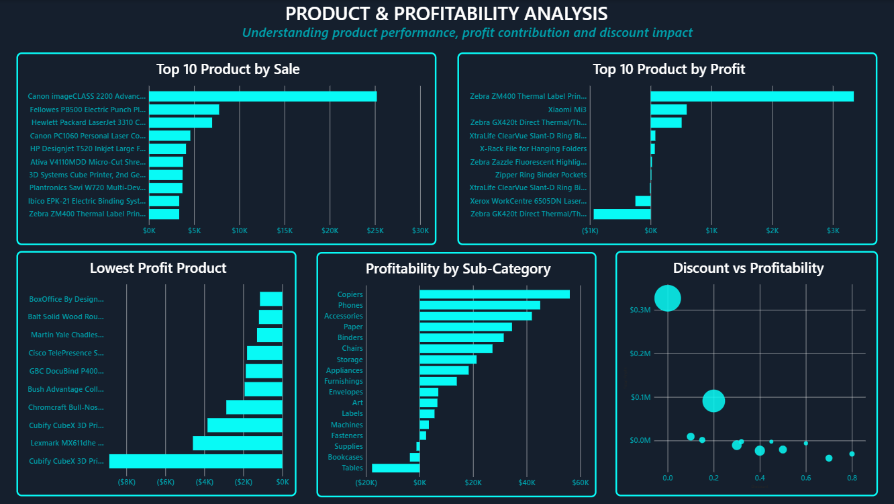
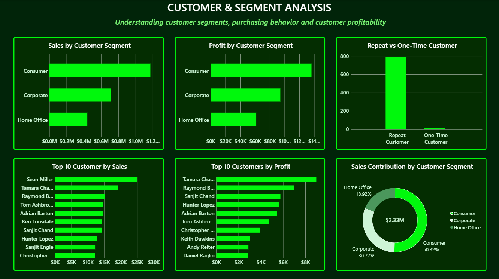
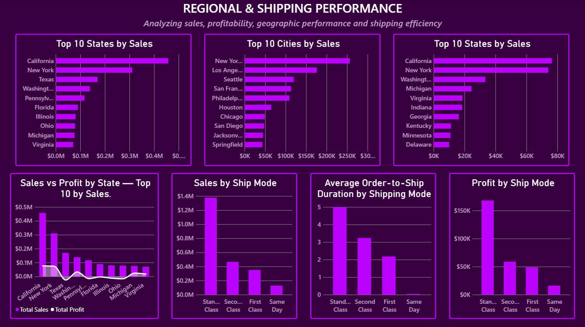

# Retail Sales & Profitability Analytics

## Project Overview
An end-to-end data analytics project exploring retail sales, profitability, customer purchasing behavior, regional performance, and shipping efficiency using SQL and Power BI.

The project demonstrates data cleaning, data validation, SQL-based analysis, DAX calculations, and interactive dashboard development.

## Tools & Technologies
- **MySQL:** Data staging, cleaning, validation, and business analysis
- **Power BI Desktop:** Data modeling, DAX measures, and interactive visualizations
- **Power Query:** Data transformation
- **GitHub:** Project documentation and version control

## Dashboard Preview

### 1. Executive Overview

### 2. Product & Profitability Analysis

### 3. Customer & Segment Analysis

### 4. Regional & Shipping Performance

## Key Areas of Analysis
- Overall sales, profit, orders, customers, and profit margin
- Category and regional performance
- Monthly sales trends
- Top-performing and least-profitable products
- Discount impact on profitability
- Customer segments and repeat purchasing
- State and city performance
- Shipping modes and order-to-ship duration

## Project Structure
- `SQL/` — SQL analysis and data-quality validation scripts
- `PowerBI/` — Interactive Power BI report
- `Screenshots/` — Dashboard preview images
- `Data/` — Source dataset folder (not necessarily included in the public repository)

## How to Explore
1. Review the SQL scripts to understand the analysis.
2. Browse the dashboard screenshots above.
3. Download the Power BI report and open it in Power BI Desktop.
4. To refresh the report, obtain the source dataset and configure the MySQL connection to your local database. The report currently uses the `retail_sales_analytics` database and `superstore_clean` table.

## Notes
This project uses a Sample Superstore dataset for learning purposes. Dataset availability and redistribution rights should be checked with the original source.
